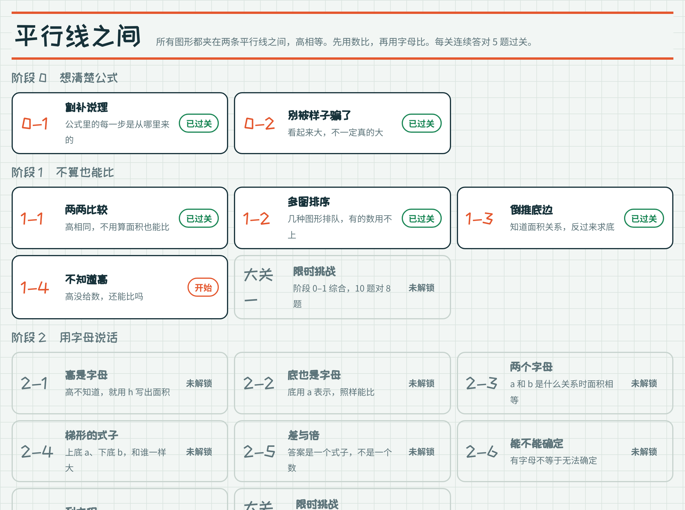
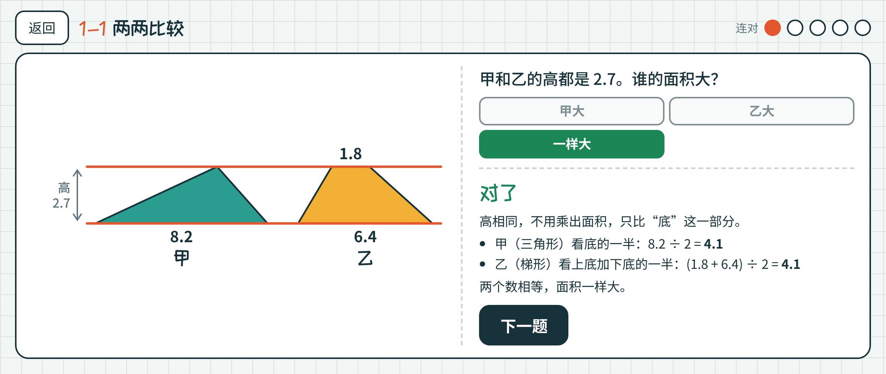
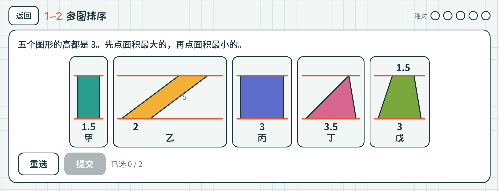
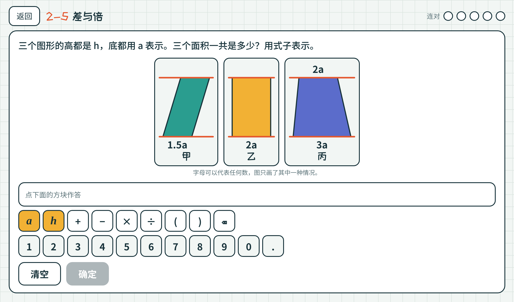

# 平行线之间 · Between Parallel Lines

**[▶ 立即试玩 · Play now](https://tigerlok.github.io/primary-math-geometry-game/)**　免费，打开网页就能玩，不用安装、不用注册。Free, runs in the browser, no install, no sign-up.

[](https://github.com/tigerlok/primary-math-geometry-game/actions/workflows/check.yml)
[](LICENSE)

[中文](#中文) · [English](#english)



---

## 中文

一个面向小学五年级学生的几何闯关游戏。所有图形都夹在两条平行线之间，高都相等。孩子从“算出面积再比”出发，一步步走到“不算也能比”，最后“用字母写出结论”。这是从算术走向代数的一小步，也是抽象思维的起点。

### 第一位玩家

第一位玩家是作者的女儿。她原先不爱数学；开始玩之后，每天主动要求再过一关。

### 一道题看懂“不算也能比”



甲是三角形，底 8.2；乙是梯形，上底 1.8、下底 6.4；高都是 2.7。谁的面积大？

不用乘出面积。高相同，只比“底”这一部分：三角形看底的一半，8.2 ÷ 2 = 4.1；梯形看上底加下底的一半，(1.8 + 6.4) ÷ 2 = 4.1。两个数相等，面积一样大。

每道题答完都有这样的讲解，答对答错都会看到。

### 从数走到字母

| 阶段 | 学什么 | 关卡 |
|---|---|---|
| 阶段 0　想清楚公式 | 割补、数格子，弄明白面积公式里每一步的来历 | 0-1、0-2 |
| 阶段 1　不算也能比 | 高相同时只比“底”；倒推底边；高不知道也能比 | 1-1 至 1-4、大关一 |
| 阶段 2　用字母说话 | 用 h、a、b 写面积；判断能不能确定；列方程 | 2-1 至 2-7、大关二 |
| 阶段 3　统一到梯形 | 五个面积公式其实是一个 | 计划中 |
| 阶段 4　字母是会变的量 | 顶点滑动、底变化时面积怎样变 | 计划中 |
| 阶段 5–6　通项 | 把三角形切成 n 层，写出“第 k 层”的式子 | 计划中 |
| 拓展　不求也能算 | 单个长度求不出，它们的组合却能求出 | 计划中 |

<table><tr>
<td width="50%"><br>阶段 1：五个图形一起比，有的数用不上</td>
<td width="50%"><br>阶段 2：答案是一个式子，点方块拼出来</td>
</tr></table>

### 为什么不会刷腻

- 目前 95 种问法，题目里的数每次随机生成，不会反复刷到同一道题。
- 同一关不连续出同一种问法（答错后的补题除外）；从 1-1 起还会穿插前面关卡的回顾题。
- 每关连续答对 5 题过关；答错一题，连对数清零，下一题出同一类，直到真正弄懂。
- 每个阶段末有限时大关，10 题对 8 题通过。
- 阶段 2 用字母答题时，写法不同但意思相同的式子都判对，比如 `2a+a` 和 `3a`。

### 给家长和老师

- 建议用平板横屏，电脑浏览器也可以。
- 进度保存在当前设备的浏览器里。首页底部有“进度码”，换设备时抄过去导入即可。
- 首页底部的“解锁全部关卡”供家长和老师审题、挑关卡布置。
- 网页在中国大陆访问可能不稳定。

### 给开发者

纯静态网页，没有构建步骤，没有依赖。把整个文件夹放到任何能托管网页的地方即可运行。

| 位置 | 内容 |
|---|---|
| `index.html` | 网页入口 |
| `css/style.css` | 外观 |
| `js/core.js` | 工具函数与画图 |
| `js/stage0.js`、`stage1.js`、`stage2.js` | 各阶段的出题程序 |
| `js/levels.js` | 关卡顺序与名称 |
| `js/ui.js` | 界面与进度保存 |
| `tests/check.js` | 自动核对程序 |
| `assets/` | 介绍用截图与分享封面图 |
| `docs/problem-registry.md` | 题目登记表 |
| `docs/progress.md` | 进度与摘要 |

自动核对：

```bash
node tests/check.js
```

每种问法随机出题 300 道，用坐标重新计算面积，逐题核对答案、选项、“无法确定”的判定和拼式子的识别；带字母的题另外代入多组随机数验证。每次提交后在 GitHub 上自动运行。

### 署名与许可

由 tigerlok 与 Claude（Anthropic 的 AI 助手）共同构建。以 MIT 许可发布：任何人可以免费使用、修改、转发，保留署名即可。

欢迎在 [Issues](https://github.com/tigerlok/primary-math-geometry-game/issues) 里提意见或报告题目错误。

---

## English

A geometry level game for Grade 5 students (about 10–11 years old). Every shape sits between two parallel lines, so all shapes have the same height. Children start by computing areas and comparing them, then learn to compare without computing, and finally write their conclusions with letters. It is a small step from arithmetic to algebra, and a starting point for abstract thinking. The interface is in Chinese.

### The first player

The first player was the author's daughter. She used to dislike maths; after she started playing, she asked every day to clear one more level.

### One question that shows the idea


Shape A is a triangle with base 8.2. Shape B is a trapezoid with top 1.8 and bottom 6.4. Both have height 2.7. Which has the larger area?

No multiplication is needed. With equal heights, compare only the "base" part: for the triangle, half the base, 8.2 ÷ 2 = 4.1; for the trapezoid, half of top plus bottom, (1.8 + 6.4) ÷ 2 = 4.1. The numbers are equal, so the areas are equal.

Every question is followed by an explanation like this, whether the answer was right or wrong.

### From numbers to letters

| Stage | What it teaches | Levels |
|---|---|---|
| Stage 0　Understand the formulas | Cutting and rearranging, counting squares: where each step of an area formula comes from | 0-1, 0-2 |
| Stage 1　Compare without calculating | With equal heights, compare only the "base"; work backwards to a base; compare even when the height is unknown | 1-1 to 1-4, Boss 1 |
| Stage 2　Speak with letters | Write areas with h, a, b; decide whether a comparison can be determined; set up equations | 2-1 to 2-7, Boss 2 |
| Stage 3　Everything is a trapezoid | The five area formulas are really one | Planned |
| Stage 4　Letters are quantities that change | How area changes as a vertex slides or a base changes | Planned |
| Stages 5–6　General terms | Slice a triangle into n layers and write the expression for layer k | Planned |
| Extension　Solve without finding | Single lengths can't be found, but their combination can | Planned |

<table><tr>
<td width="50%"><br>Stage 1: compare five shapes at once; some numbers are distractors</td>
<td width="50%"><br>Stage 2: the answer is an expression, built by tapping tiles</td>
</tr></table>

### Why it doesn't get repetitive

- 95 question types so far. The numbers are generated randomly each time, so the same question rarely comes back.
- Within a level, the same question type is not asked twice in a row (except the follow-up after a wrong answer). From level 1-1 on, review questions from earlier levels are mixed in.
- Five correct answers in a row clear a level. A wrong answer resets the streak, and the next question is of the same type, until it is truly understood.
- Each stage ends with a timed boss level: 8 out of 10 to pass.
- In Stage 2, expressions that are written differently but mean the same thing are all accepted, e.g. `2a+a` and `3a`.

### For parents and teachers

- A tablet in landscape works best; a desktop browser also works.
- Progress is saved in the browser on the current device. A "progress code" at the bottom of the home screen lets you move progress to another device.
- "Unlock all levels" at the bottom of the home screen lets parents and teachers preview questions and pick levels to assign.
- Access from mainland China may be unstable.

### For developers

A purely static site: no build step, no dependencies. Put the folder on any static web host and it runs.

| Path | Contents |
|---|---|
| `index.html` | Entry page |
| `css/style.css` | Styles |
| `js/core.js` | Utilities and drawing |
| `js/stage0.js`, `stage1.js`, `stage2.js` | Question generators for each stage |
| `js/levels.js` | Level order and names |
| `js/ui.js` | Interface and progress saving |
| `tests/check.js` | Automated checker |
| `assets/` | README screenshots and social preview image |
| `docs/problem-registry.md` | Problem registry (Chinese) |
| `docs/progress.md` | Progress notes (Chinese) |

Automated check:

```bash
node tests/check.js
```

For every question type it generates 300 random questions, recomputes areas from coordinates, and checks the answer, the choices, "cannot be determined" verdicts, and expression recognition. Questions with letters are also checked by substituting several sets of random values. It runs automatically on GitHub after every commit.

### Credits and license

Built by tigerlok together with Claude (Anthropic's AI assistant). Released under the MIT License: anyone may use, modify and share it for free, as long as the attribution is kept.

Feedback and reports of wrong questions are welcome in [Issues](https://github.com/tigerlok/primary-math-geometry-game/issues).
